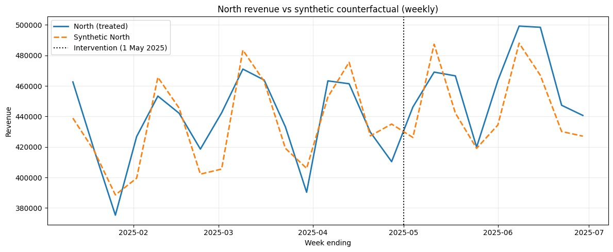
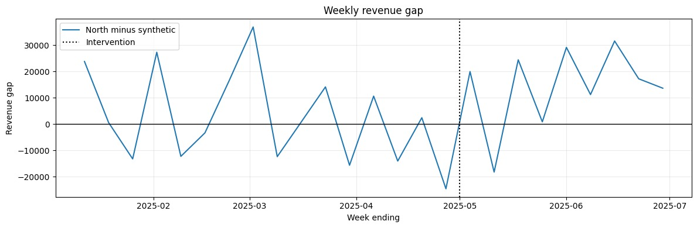

# Causal Inference & Synthetic Control Engine for Algorithmic Pricing

> **Data Analytics Project | Zaalima Development**  
> Estimating the revenue gap associated with a simulated algorithmic-pricing intervention using synthetic control.

## Project Overview

This project explores whether a simulated pricing intervention in one region is followed by a revenue change relative to an estimated counterfactual built from untreated regions.

**Business question:** How did North's revenue compare with an estimate of what North might have earned without the simulated pricing intervention?

The workflow includes data validation, exploratory data analysis (EDA), causal assumptions represented with a Directed Acyclic Graph (DAG), treatment-period preparation, synthetic-control estimation, and robustness checks.

> **Important:** The dataset is synthetic and intended for educational and analytical purposes. It does not contain real company or customer transactions. Estimates are methodological demonstrations, not proof of real-world business impact.

## Dataset at a Glance

| Item | Description |
|---|---|
| Dataset | `project1_algorithmic_pricing_synthetic_dataset.csv` |
| Observations | 540 |
| Variables | 11 |
| Regions | North, South, West |
| Frequency | Daily |
| Date range | January 1 – June 29, 2025 |
| Treated region | North |
| Intervention date | May 1, 2025 |
| Comparison / donor regions | South and West |
| Simulated intervention | Approximately 7% price increase in North |

### Key variables

- `date` — observation date
- `region` — North, South, or West
- `our_price` — simulated selling price
- `competitor_price` — simulated competitor price
- `units_sold` — units sold
- `revenue` — sales revenue
- `treatment` — intervention indicator
- `period` — pre-treatment or post-treatment period
- `marketing_spend` — simulated marketing expenditure
- `promotion_active` — promotion indicator
- `product_category` — product category

## Methodology

### 1. Data validation

Checks include missing values, duplicate rows and date-region-category combinations, date coverage, data types, negative or invalid numeric values, treatment labels, revenue consistency, and potential outliers.

### 2. Exploratory data analysis

Compare total revenue by region, average own price versus competitor price, and revenue trends over time. These summaries help characterize the data before causal modelling.

### 3. Causal assumptions and treatment timing

A Directed Acyclic Graph (DAG) documents assumed relationships among treatment, price, units sold, revenue, competitor prices, marketing, and promotions. North is treated from May 1, 2025; South and West are potential donor regions.

A DAG records assumptions; it does not prove causality.

### 4. Synthetic-control estimation

The model selects non-negative weights for South and West that sum to one, aiming to reproduce North's revenue during the pre-treatment period.

The synthetic counterfactual is:

$$
\widehat{Y}_{North,t}
= w_{South}Y_{South,t} + w_{West}Y_{West,t}
$$

The estimated revenue gap is:

$$
Gap_t = Y_{North,t} - \widehat{Y}_{North,t}
$$

A positive gap means observed North revenue is above synthetic North revenue. Interpreting that gap causally requires credible counterfactual assumptions.

### 5. Model fit and robustness

- **Pre-treatment RMSE / normalized RMSE:** assesses how closely synthetic North matches actual North before the intervention.
- **Placebo-in-time checks:** assign false intervention dates before the actual date and inspect the resulting gaps.
- **Daily versus weekly comparison:** assesses whether estimates depend on aggregation frequency.
- **Donor sensitivity:** compares South and West together and each donor separately.
- **Visual diagnostics:** plots actual and synthetic revenue and the gap over time.

**Timing note:** The week ending May 4, 2025 includes both pre- and post-intervention days. The updated weekly analysis excludes that mixed boundary week from the post-treatment calculation; daily analysis uses May 1 as the intervention date.

## Visual Results

The following figures were generated by running `05_synthetic_control_robustness_updated.ipynb` in Google Colab. They show weekly model outputs for the simulated dataset.

### Actual North revenue vs. synthetic counterfactual

*The blue line is observed North revenue; the orange dashed line is the weighted synthetic comparison. The vertical dotted line marks the intervention date. The pre-intervention differences indicate that the counterfactual fit is not perfect.*

### Weekly revenue gap

*The gap is observed North revenue minus synthetic North revenue. Values above zero indicate North revenue was higher than its synthetic estimate for that week; values below zero indicate it was lower.*

## Preliminary Findings

The updated notebook was run successfully in Google Colab. Its current output reports:

| Diagnostic | Result |
|---|---:|
| Weekly mean post-intervention revenue gap | **+3.0%** |
| Daily mean post-intervention revenue gap | **+4.4%** |
| Weekly pre-treatment normalized RMSE | **4.0%** |
| Daily pre-treatment normalized RMSE | **9.8%** |
| South donor weight in weekly model | **47.17%** |
| West donor weight in weekly model | **52.83%** |

The weekly calculation excludes the mixed week ending May 4, 2025. The daily and weekly estimates differ, and the pre-treatment gap fluctuates, so the results should be interpreted cautiously. A positive gap is not by itself proof that the pricing intervention caused the revenue difference.

These are preliminary, specification-dependent results from a simulated dataset. Re-run and verify outputs after any code or data changes. Donor sensitivity has previously produced materially different estimates when South and West are used separately, so the gap should not be presented as definitive causal proof.

## Repository Guide

| File | Purpose |
|---|---|
| `01_data_validation.ipynb` | Initial data-quality checks and cleaned-data export |
| `01b_data_validation_extended.ipynb` | Extended data-quality checks and validation summary |
| `Exploratory Data Analysis.ipynb` | Regional revenue, price comparisons, and revenue trends |
| `Causal DAG.ipynb` | Causal assumptions and DAG-related analysis |
| `Treatment period & integration.ipynb` | Defines treatment timing and exports pre/post-period datasets |
| `02_model_data_prep.ipynb` | Prepares daily and weekly modelling tables |
| `03_model_data_validation.ipynb` | Validates prepared model inputs |
| `03_synthetic_control.ipynb` | Synthetic-control estimation and revenue-gap analysis |
| `04_model_input_assumption_checks.ipynb` | Checks modelling inputs and assumptions |
| `week1_report.md` | Week 1 progress and findings |
| `week2_synthetic_control.ipynb` | Week 2 synthetic-control work |
| `05_synthetic_control_robustness.ipynb` | Original robustness setup and placebo analysis |
| `05_synthetic_control_robustness_updated.ipynb` | Expanded robustness checks on the `Dhananjay` branch |
| `north_vs_synthetic_weekly.jpeg` | Actual versus synthetic North revenue chart |
| `weekly_revenue_gap.jpeg` | Weekly revenue-gap chart |
| `project1_algorithmic_pricing_synthetic_dataset.csv` | Synthetic input dataset |
| `project1_algorithmic_pricing_cleaned.csv` | Cleaned-data output, if generated by the validation workflow |

## Limitations and Open Checks

- The dataset is simulated, not real business data.
- The donor pool contains only two regions.
- Estimates may be sensitive to donor choice and data frequency.
- Good pre-treatment fit does not guarantee a valid post-treatment counterfactual.
- Placebo checks are diagnostic; they do not by themselves establish statistical significance.
- The Week 1 report flags differences between recorded revenue and `our_price × units_sold`. Reconcile this with the validation notebook's reported status before claiming that revenue consistency is fully resolved.
- The project brief mentions Double Machine Learning (DML); verify its implementation before claiming it is complete.
- Dashboard and final-report deliverables should be marked complete only once implemented and verified.

## Team Contributions

The descriptions below summarize work visible in the repository branches and notebooks. They describe documented artifacts, not a claim that every cell has been independently validated.

### Harishwar

- **Initial data validation:** checks missing values, duplicates, data types, invalid dates and numeric values, region values, and treatment assignment; includes a cleaned-data export.
- **Exploratory data analysis:** examines region-wise revenue, own versus competitor pricing, and daily revenue trends.
- **Causal DAG:** documents assumed relationships among treatment, prices, units sold, revenue, marketing, promotions, and competitor pricing; includes DoWhy-related identification code.
- **Treatment-period integration:** defines the intervention date, separates pre- and post-treatment observations, and exports the two datasets.
- **Week 1 reporting:** documents the dataset, validation, EDA, and causal assumptions.
- **Week 2 synthetic control:** prepares regional revenue data, optimizes donor weights, constructs synthetic North, calculates revenue gaps, plots the actual and synthetic series, and exports results.

### Dhananjay Lingam

- **Extended data validation:** expanded checks for date-region-category uniqueness, date coverage, revenue consistency, outliers, and a PASS/FAIL summary.
- **Treatment-period preparation:** worked on defining the intervention date and separating pre- and post-treatment data.
- **Synthetic-control analysis:** worked on preparing regional revenue series, fitting donor weights, comparing actual North with synthetic North, and assessing the revenue gap and pre-treatment fit.
- **Expanded robustness analysis:** added checks for placebo dates, daily versus weekly estimates, donor sensitivity, and visual diagnostics. The weekly analysis also calls attention to the mixed week ending May 4.
- **Integration and review preparation:** organized project work on the `Dhananjay` branch and prepared methodology, limitations, visualisations, and review materials.

## Project Status

The repository documents work on data validation, EDA, causal assumptions, treatment-period preparation, synthetic-control estimation, and robustness analysis. Treat robustness as in progress until all checks and outputs have been rerun and reviewed. Treat any dashboard or DML component as incomplete unless its implementation can be demonstrated.

## Disclaimer

This project is for educational and methodological demonstration only. It is not a recommendation for real-world pricing decisions and should not be interpreted as verified causal effects.

